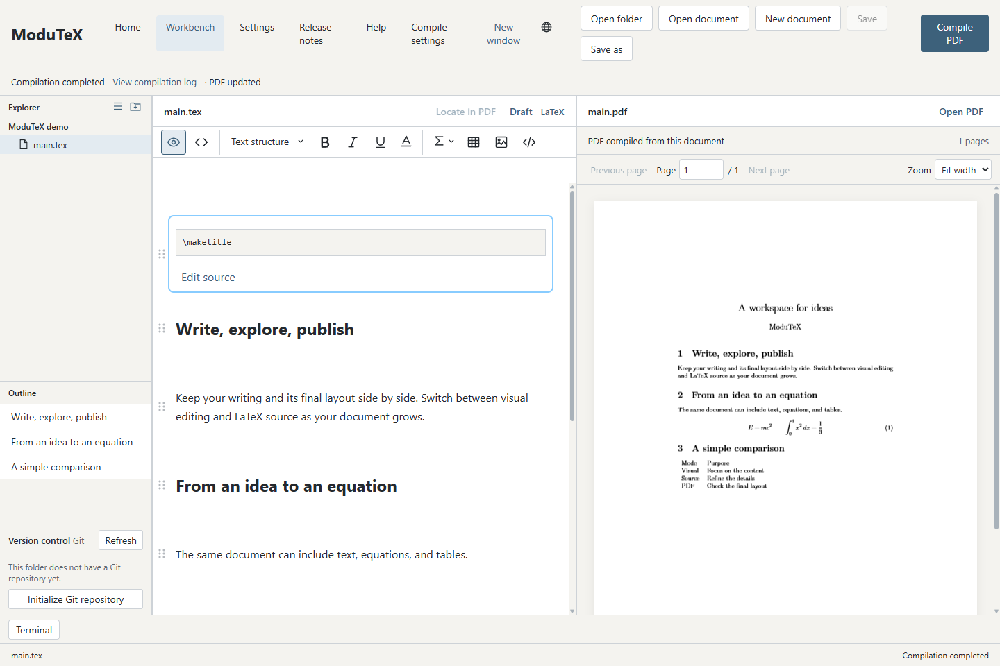
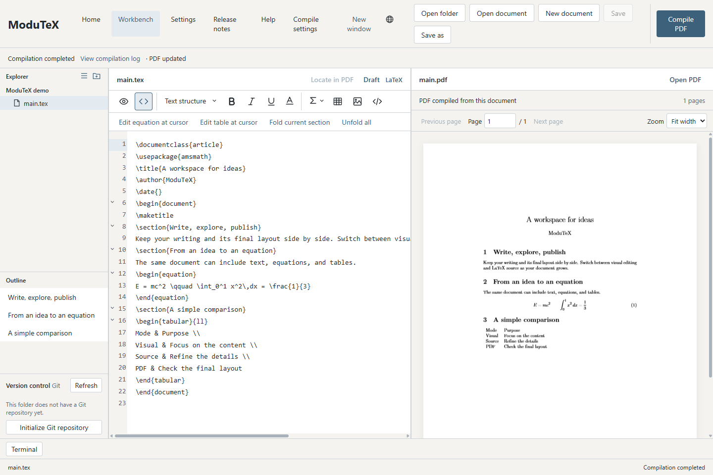
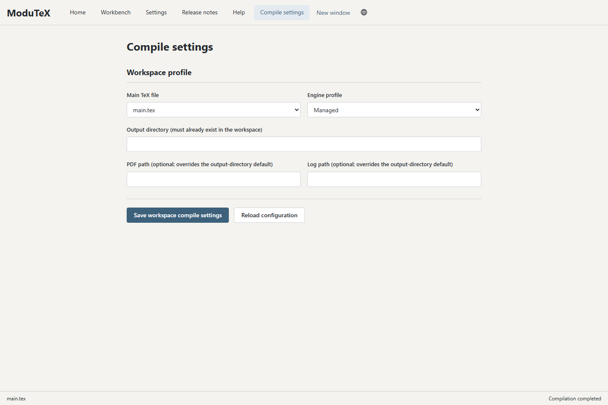

<p align="center"></p>
<h1 align="center">ModuTeX</h1>
<p align="center">Visual LaTeX editing with a built-in compiler.</p>
<p align="center"><a href="README.md">English</a> · <a href="README.zh-TW.md">繁體中文</a></p>

ModuTeX combines visual editing, LaTeX source editing, and PDF preview in a unified desktop workspace powered by Tauri 2 and Svelte.
Write text, build equations and tables, and compile documents locally with the bundled Tectonic engine.



## Screenshots

Switch to LaTeX source while keeping the PDF in view.



Choose the main document, compiler profile, and output paths for each workspace.



## Features

- **Visual and source editing:** Edit rich content directly with synchronized undo/redo, or switch to LaTeX source for custom macros and packages.
- **Notebook cells:** Organize text, headings, and sections into draggable notebook-style cells.
- **Equations and matrices:** Visual template palettes for fractions, limits, calculus, and matrix structures.
- **Tables, code and images:** Manage table geometries, code blocks with syntax highlighting, and embedded images.
- **Integrated PDF preview:** Live side-by-side compilation with error diagnostics and fallback to the last successful render.
- **Dual language support:** English and Traditional Chinese interface.

## Usage

ModuTeX 0.3.0 targets **Windows x64**.
Downloads are published on [GitHub Releases](https://github.com/leo2783/ModuTeX/releases).

1. Launch ModuTeX and choose **New document**, **Open file**, or **Open folder**.
2. Edit visually or switch to Source mode.
3. Click **Compile PDF** to build the document using the integrated engine.

## Development

### Prerequisites

- Windows x64
- Node.js `24.19.0` and npm `11.17.0`
- Rust (stable MSVC) with `wasm32-unknown-unknown` target (`rustup target add wasm32-unknown-unknown`)

### Build and Run

Install dependencies and compile the desktop application:

```powershell
npm ci

# Build the frontend and release Tauri desktop executable
npm run build

# Launch the compiled Tauri executable directly
npm run tauri
```

### Verification and Tests

```powershell
npm run frontend:check
npm run frontend:test
```

## License

Original code in the current Tauri application is licensed under [Apache-2.0](LICENSE).
See [LICENSING.md](LICENSING.md) for details on source scopes.
