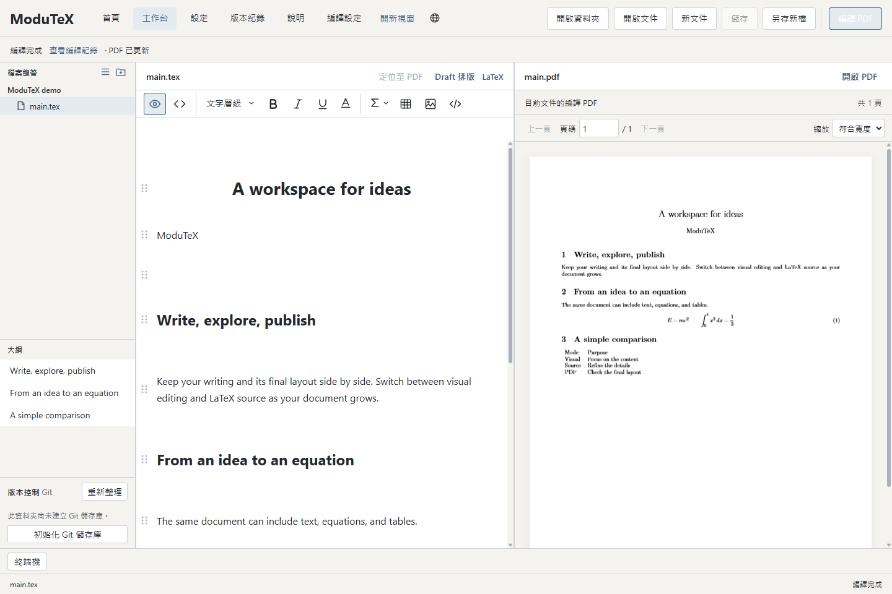
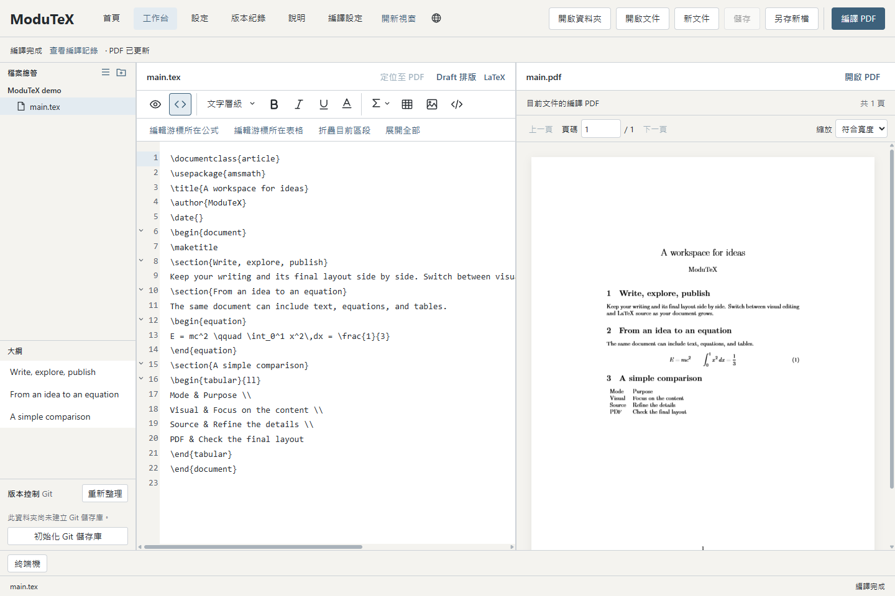
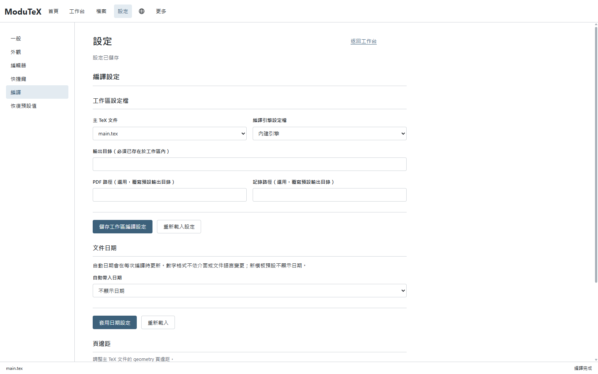

<p align="center"></p>
<h1 align="center">ModuTeX</h1>
<p align="center">內建編譯器的視覺化 LaTeX 編輯器。</p>
<p align="center"><a href="README.md">English</a> · <a href="README.zh-TW.md">繁體中文</a></p>

ModuTeX 以 Tauri 2 與 Svelte 架構打造，將視覺化編輯、LaTeX 原始碼編輯與 PDF 預覽整合在單一桌面工作區。
可直接撰寫文字、建立公式與表格，並透過內建的 Tectonic 引擎本機編譯。



## 介面預覽

可切換至 LaTeX 原始碼，並同時查看 PDF 排版。



為每個工作區選擇主文件、編譯引擎與輸出路徑。



## 主要功能

- **視覺與原始碼雙模式**：直接編輯格式化內容並共用復原記錄，亦可切換至原始碼模式編輯進階 LaTeX 巨集。
- **Notebook 儲存格**：透過可拖曳的區塊結構組織標題、摘要與內文段落。
- **公式與矩陣**：視覺化數學模板庫，涵蓋分數、極限、微積分及各類矩陣排版。
- **表格、程式碼與圖片**：自訂欄寬與行列結構、程式碼語法標亮，以及圖片插入。
- **整合式 PDF 預覽**：並列即時編譯與診斷日誌，編譯失敗時自動保留前次成功畫面。
- **雙語介面**：可以選擇繁體中文或英文。

## 使用說明

ModuTeX 0.3.0 適用於 **Windows x64**。
發行版本可至 [GitHub Releases](https://github.com/leo2783/ModuTeX/releases) 下載。

1. 啟動 ModuTeX 並選擇「新文件」、「開啟檔案」或「開啟資料夾」。
2. 在視覺模式編輯，或切換原始碼模式輸入 LaTeX 指令。
3. 點選「編譯 PDF」，完成編譯與預覽。

## 開發建置

### 環境需求

- Windows x64
- Node.js `24.22.1` 與 npm `11.19.1`
- Rust（穩定版 MSVC 工具鏈）與 `wasm32-unknown-unknown` 目標（`rustup target add wasm32-unknown-unknown`）

### 建置與執行

安裝相依套件並編譯桌面應用程式：

```powershell
npm ci

# 建置前端與 Tauri Release 執行檔
npm run build

# 直接啟動已建置的 Tauri 執行檔
npm run tauri
```

### 驗證與測試

```powershell
npm run frontend:check
npm run frontend:test
```

## 授權條款

ModuTeX 原始碼採用 [Apache-2.0](LICENSE) 授權。
各模組範圍與第三方聲明請參閱 [LICENSING.md](LICENSING.md)。
