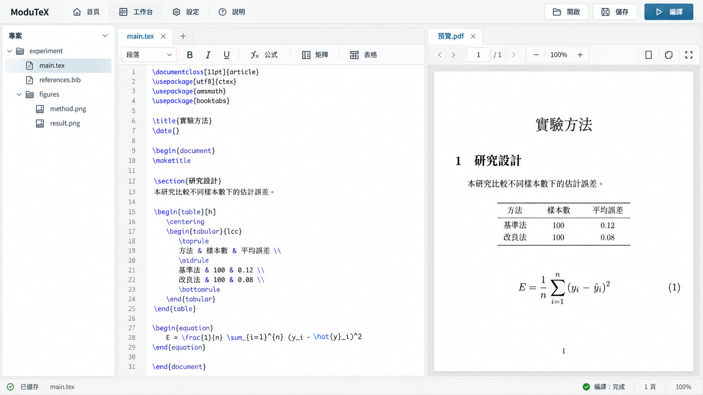
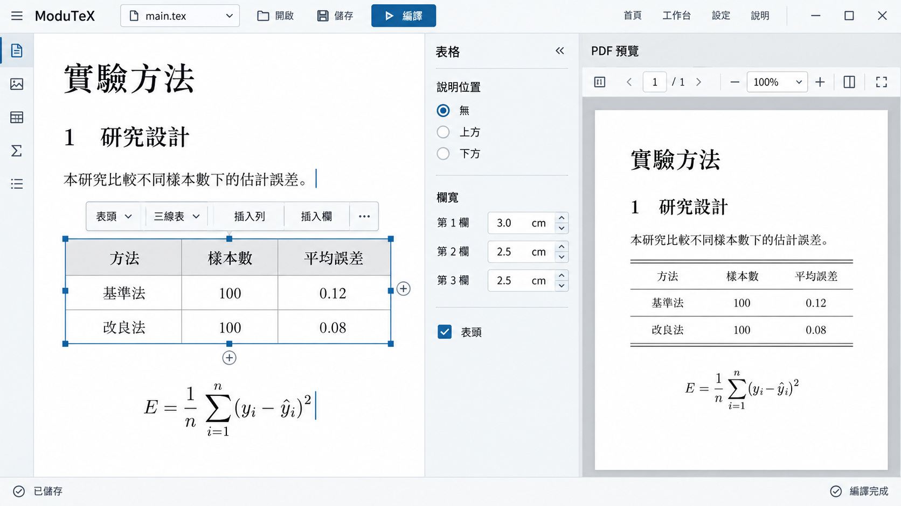
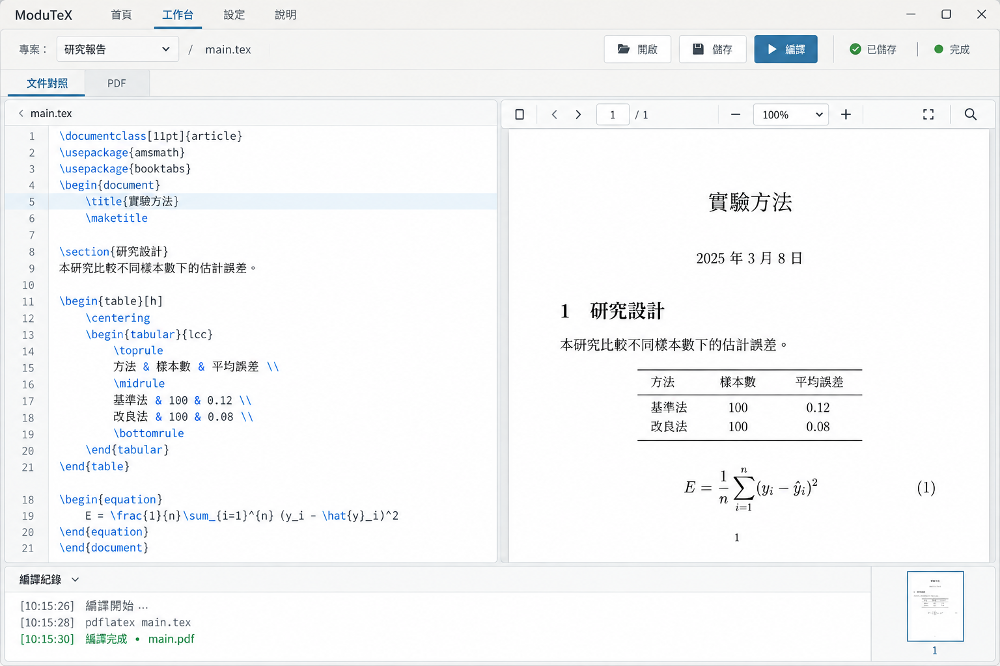

# 工作台圖片稿

依 [產品簡報](PRODUCT.md) 與核准 ASCII 圖，固定低彩度方向、僅比較構圖。示範文件為自行編寫的虛構資料，圖片不是已完成的功能截圖。

- 模式：Operate。
- A：檔案／原始碼／PDF 三欄，常用操作在頂部。
- B：視覺文件／表格工具／PDF，檔案抽屜按需開啟。
- C：原始碼／PDF 雙欄，下方為編譯診斷。

生成結果的 A、C 未呈現原先要求的視覺對照；這兩張僅供原始碼模式構圖選擇，不據此取消核准計畫中的視覺編輯與對照功能。文字、公式與 PDF 排版的生成誤差不得直接當成功能規格。

## 圖片

### A：檔案導向

### B：視覺文件導向

### C：來源與診斷導向

選定稿：A。使用者於 2026-10-07 明確表示「我喜歡這排版」，並要求補齊 TeX、視覺編輯、終端機、展開工具、上方工具列、版本紀錄與設定圖片稿。

approvedComp: `.impeccable/mocks/workbench-a.png`

A 的檔案／文件／PDF 三欄、低彩度配色及頂部操作列作為基準；生成文字與 TeX 語法不直接轉成實作規格。新增狀態見 [A 版面延伸稿](WORKBENCH_STATES.md)。使用者確認「視覺大致上沒問題」，並同意真實 PDF 與可操作 Svelte 元件方式；不將核准外觀當成功能驗收。

## Direction contract

- 模式與任務：Operate；開啟文件、編輯、編譯並對照 PDF。
- 構圖：頂部常用操作、檔案／文件／PDF 三欄；工具與終端機按需展開。
- 視覺：低彩度淺色、細框線與明確焦點；不使用螢光色。
- 字體與內容：介面使用系統字體；PDF 依真實文件字型，不照搬圖片生成的公式字型建議。
- 實作：語意元件、真實來源與 PDF.js；圖片只作設計參考，禁止裁切稿冒充功能。
- 邊界：新 renderer 不 import legacy；保留 Electron host 的既有授權，實際桌面操作另行驗收。
