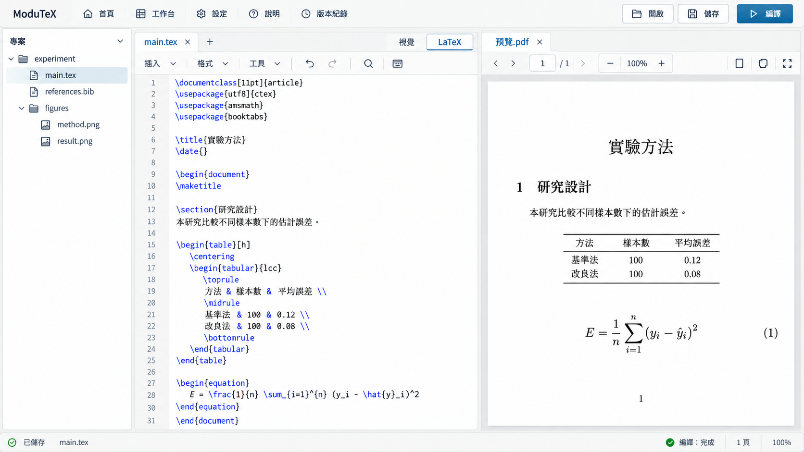
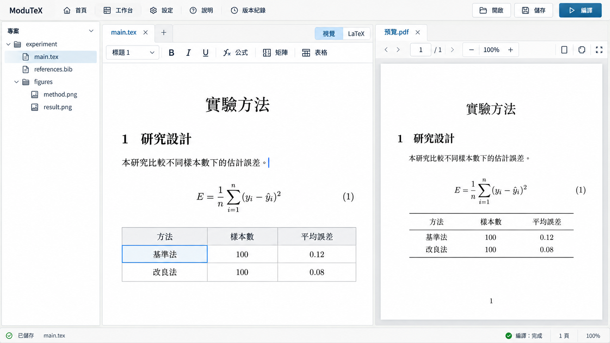
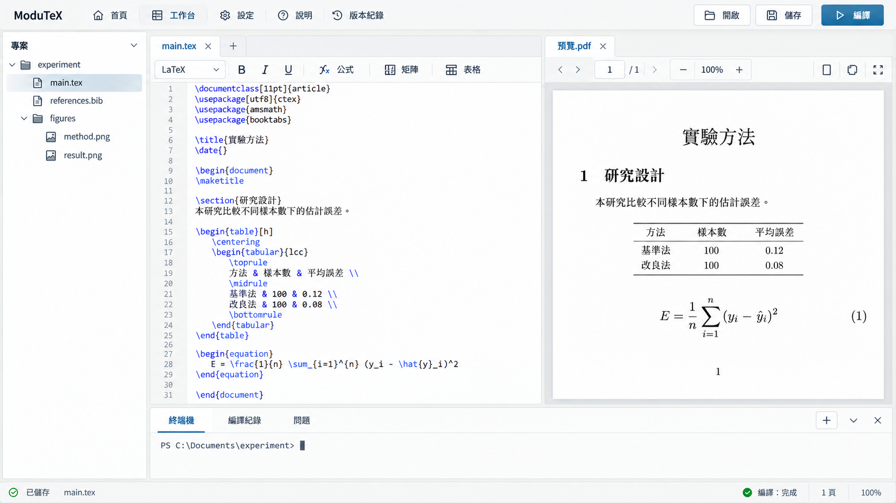
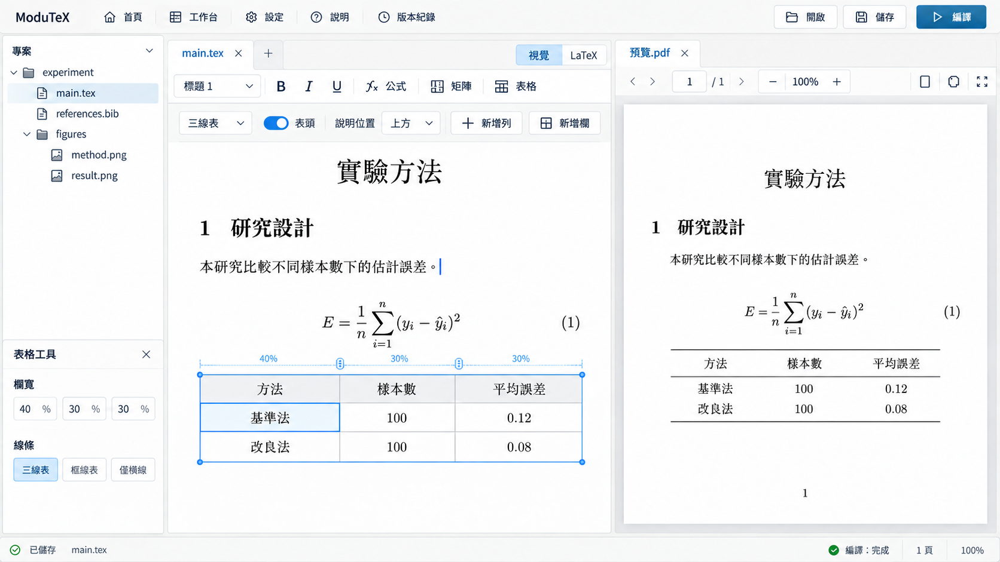
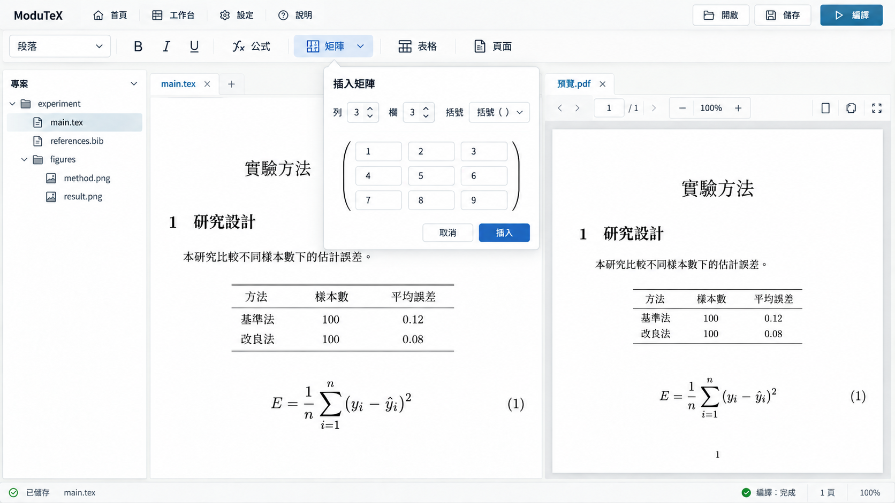
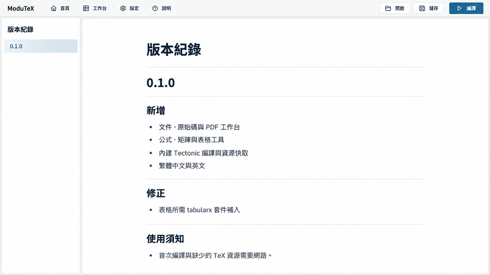
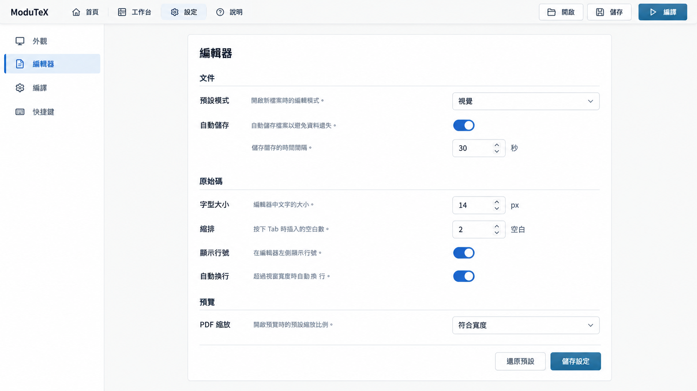

# A 版面延伸稿

基準：[使用者選定的 A](WORKBENCH_BRIEF.md)。以下為 2026-10-07 生成的設計稿，不是實際功能截圖。沿用三欄工作台、低彩度與頂部常用操作；圖片中的文字、圖示及公式生成誤差不直接作為程式規格。

| 狀態 | 設計重點 |
|---|---|
| TeX | 檔案樹、來源編輯、PDF；工具列依來源模式切換 |
| 視覺編輯 | 可編輯段落、公式與表格；PDF 維持獨立預覽 |
| 終端機 | 下方可收合 dock，不另開外部視窗 |
| 表格工具 | 選取表格時顯示欄寬、線條、表頭、說明位置與新增行列 |
| 上方工具 | 矩陣按鈕展開具列／欄尺寸的插入面板，取消後回到文件 |
| 版本紀錄 | 版本索引與可閱讀的變更內容，不加入自動更新功能 |
| 設定 | 分類導覽、對齊的欄位與明確儲存動作 |

## TeX

## 視覺編輯

## 終端機

## 表格工具

## 上方工具

## Release notes

## Settings

## 實作邊界

終端機是本輪新增的視覺概念；正式 shell 接入需另訂啟動、工作區權限、取消與資源釋放契約，不使用假輸出冒充。設定選項為提案，須接上真實持久化才算完成。版本紀錄內容取自目前 CHANGELOG，未虛構未發布版本。

表格寬度總和、矩陣 1–10 範圍、Esc／取消／關閉、焦點返回與未保存保護以實作計畫為準。來源／視覺切換保留原文件 bytes；視覺欄中的輔助框線不等於 PDF 輸出線條。

圖片檢視：七張均保留文件工作台的配色與操作層級；表格工具首稿錯誤呈現來源碼，已重生為視覺稿。部分工具／設定／版本紀錄圖片未完整呈現模式切換或版本導覽入口；正式語意介面必須提供一致的入口與模式標記，不照搬漏項。工具列位置依來源／視覺與選取內容切換，原始碼模式不直接套用字型格式。

生成方式：原生 imagegen；精確 prompts 與來源路徑保存在各 PNG 的 `.json` sidecar，並嵌入圖片 metadata。A 與延伸方向已由使用者確認；實際功能狀態見 [實作清單](../architecture/FRONTEND_REWRITE_STATUS.md)，不以圖片代替驗收。
